# HITL Video Review

Pipeline **review video pelatihan bank** dengan pendekatan *Human-In-The-Loop*. AI melakukan pra-penyaringan setiap video terhadap checklist, lalu reviewer manusia hanya memeriksa bagian yang ditandai, dan keputusan akhir tetap di tangan manusia.

> **Catatan:** ini proyek portofolio/belajar, bukan sistem bank sungguhan. Semua video dan data uji adalah simulasi. Arsitektur sengaja dirancang agar sebagian besar berjalan di free tier.

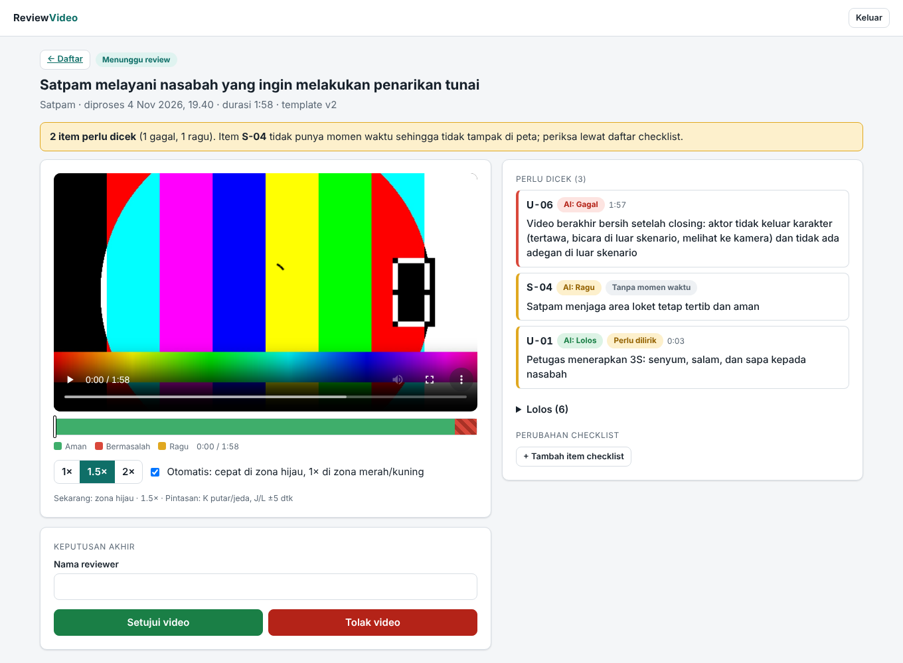

---

## Daftar isi
1. [Masalah yang diselesaikan](#1-masalah-yang-diselesaikan)
2. [Ringkasan solusi](#2-ringkasan-solusi)
3. [Arsitektur dan alur](#3-arsitektur-dan-alur)
4. [Tech stack](#4-tech-stack)
5. [Cara kerja pipeline AI](#5-cara-kerja-pipeline-ai)
6. [Checklist dan template](#6-checklist-dan-template)
7. [Model data](#7-model-data)
8. [API](#8-api)
9. [Dashboard](#9-dashboard)
10. [Struktur proyek](#10-struktur-proyek)
11. [Menjalankan lokal](#11-menjalankan-lokal)
12. [Deploy ke AWS](#12-deploy-ke-aws)
13. [Keamanan](#13-keamanan)
14. [Pengujian](#14-pengujian)
15. [Keputusan desain](#15-keputusan-desain)
16. [Keterbatasan dan rencana](#16-keterbatasan-dan-rencana)

---

## 1. Masalah yang diselesaikan

Sebuah tim pelatihan menerima sekitar **300 video per minggu** (maksimum 5 menit, MP4, Bahasa Indonesia formal). Peserta memerankan skenario layanan (satpam, teller, customer service). Setiap video harus dicek terhadap daftar kriteria: sapaan 3S, verifikasi KTP, kelengkapan prosedur, penutup yang benar, dan seterusnya.

Menonton semuanya secara manual lambat dan tidak konsisten antar reviewer. Tetapi menyerahkan keputusan sepenuhnya ke AI juga tidak aman, karena model bisa salah menilai atau mengarang bukti.

## 2. Ringkasan solusi

1. Peserta mengunggah video, mengisi **judul skenario** dan memilih **peran** (satpam / teller / cs).
2. Sistem membuat atau memakai ulang **checklist** untuk skenario itu.
3. **Gemini** mentranskrip audio dan menilai tiap item: `pass`, `fail`, atau `uncertain`, lengkap dengan **bukti (kutipan ucapan, detik frame)** dan **timestamp**.
4. Reviewer membuka dashboard: video dengan **heatmap** (hijau aman, merah bermasalah, kuning ragu), kecepatan **1.5× di zona aman dan 1× di zona bermasalah** secara otomatis, dan checklist yang bisa diklik untuk melompat ke momen terkait.
5. Reviewer bisa **menimpa** penilaian AI per item, **mengedit checklist**, lalu menekan **Setujui** atau **Tolak**.

Prinsip utamanya: **AI mengusulkan, manusia memutuskan.** Hasil AI dan keputusan reviewer disimpan terpisah, jadi penilaian asli AI tidak pernah tertimpa.

## 3. Arsitektur dan alur

### 3.1 Gambaran besar

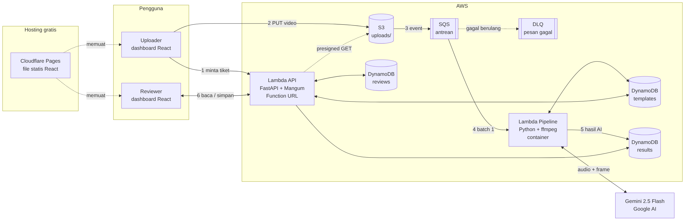

Dua Lambda berbeda dengan sengaja:
- **Pipeline**: berat (ffmpeg, panggilan Gemini, durasi menit), dipicu SQS.
- **API**: ringan, dipanggil dashboard lewat Function URL.

### 3.2 Alur unggah sampai hasil AI siap

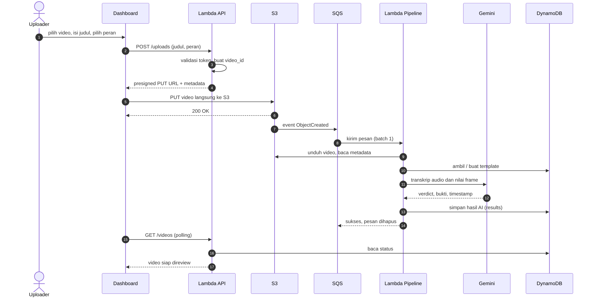

Video diunggah **langsung ke S3** lewat presigned URL, jadi tidak melewati Lambda dan tidak ada batas ukuran payload API. `role` dan `title` ikut sebagai metadata objek (`x-amz-meta-role`, `x-amz-meta-title`) sehingga pipeline tahu konteksnya tanpa tabel tambahan.

### 3.3 Alur kerja pipeline AI

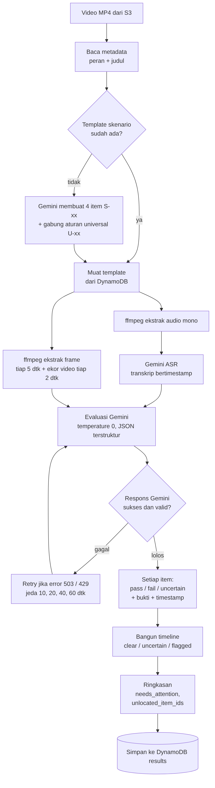

### 3.4 Alur review oleh manusia

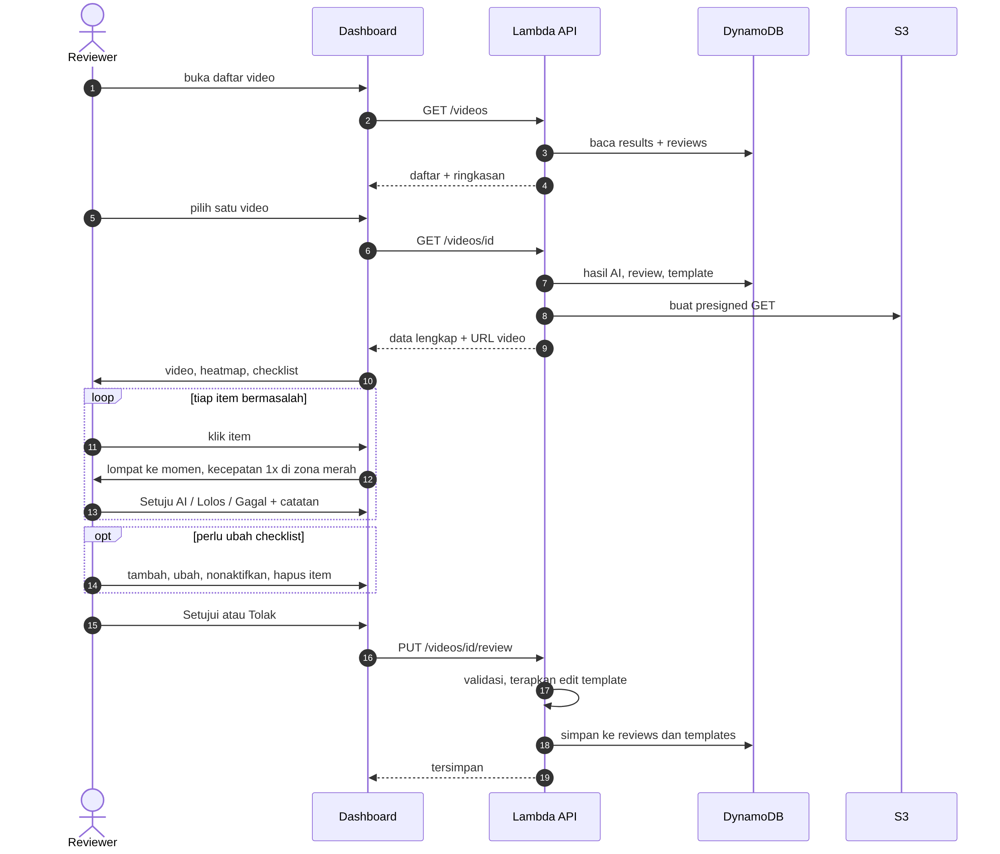

### 3.5 Siklus status video

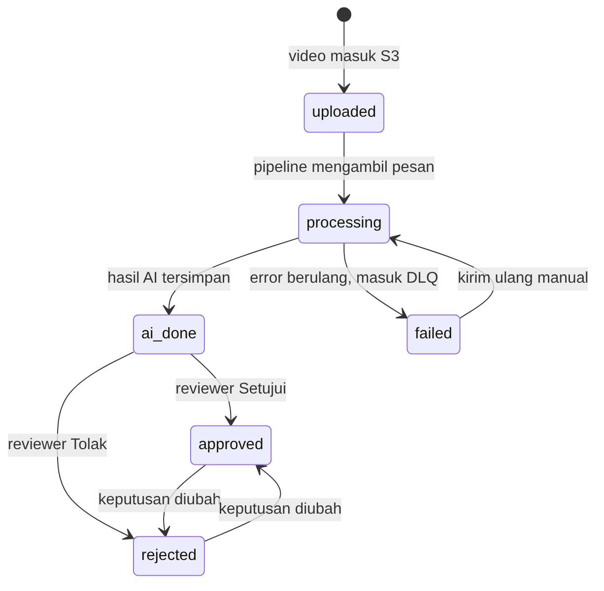

Status mengikuti enum `VideoStatus` di `core/schemas.py`. Keputusan reviewer masih bisa diubah setelahnya.

### 3.6 Kepemilikan data

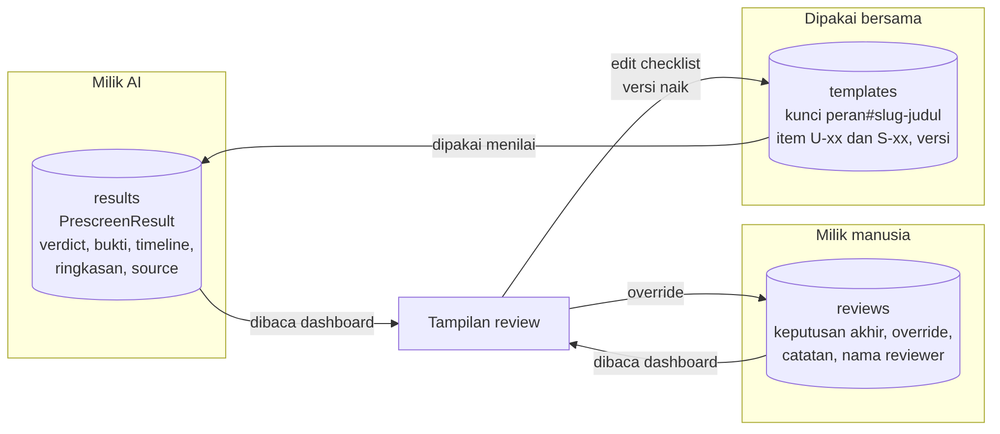

Hasil AI dan keputusan manusia **sengaja di tabel terpisah**: penilaian asli AI tidak pernah tertimpa, sehingga selalu bisa diaudit dan dibandingkan dengan keputusan reviewer.

### 3.7 Penanganan error dan retry

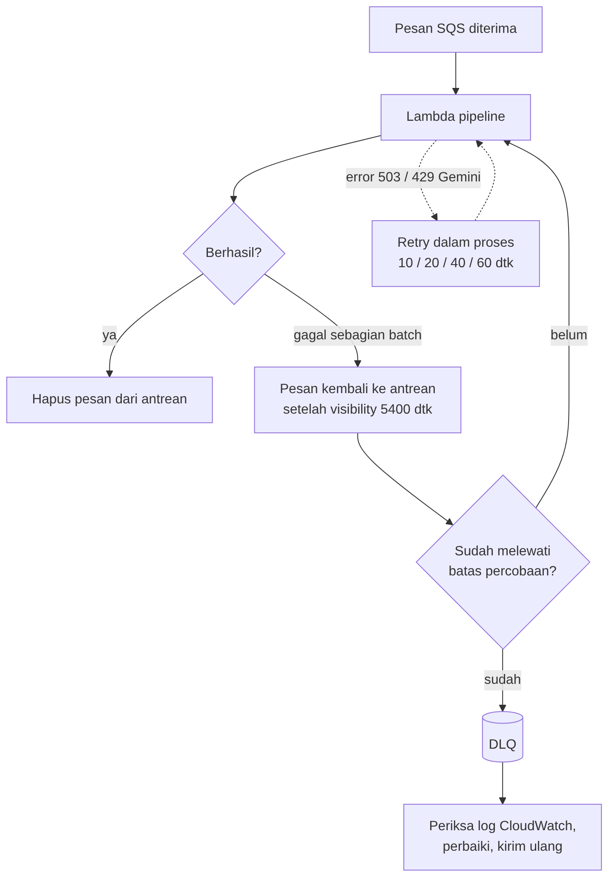

## 4. Tech stack

| Lapisan | Teknologi |
|---|---|
| AI | Google **Gemini 2.5 Flash** (transkripsi audio, evaluasi multimodal terstruktur, pembuatan checklist) via `google-genai` |
| Bahasa backend | Python 3.12, **Pydantic v2** sebagai kontrak data |
| Pemrosesan media | **ffmpeg** (binary statis dari `mwader/static-ffmpeg`): ekstrak audio dan frame |
| Compute | **AWS Lambda** berbasis container image (ECR) |
| Antrean | **Amazon SQS** + Dead Letter Queue, *partial batch response* |
| Penyimpanan objek | **Amazon S3** (video, presigned URL) |
| Database | **Amazon DynamoDB** (mode *provisioned* 5/5 supaya tetap gratis) |
| API | **FastAPI** dibungkus **Mangum** di Lambda Function URL |
| Frontend | **React 19 + TypeScript + Vite 7**, CSS biasa (tema terang/gelap, responsif) |
| Hosting frontend | Cloudflare Pages / Vercel (gratis) |
| Pengujian | `pytest`-style untuk backend, `node --test` + tsx untuk logika frontend, Playwright untuk uji end-to-end UI |
| Kontainer | Docker |

## 5. Cara kerja pipeline AI

Seluruhnya diorkestrasi di `core/pipeline.py` dan dipanggil oleh `handler.py`.

1. **Ekstrak audio** (`core/audio.py`): ffmpeg mengubah video menjadi audio mono untuk dikirim ke Gemini.
2. **Transkripsi** (`core/asr_gemini.py`): Gemini menghasilkan segmen ucapan bertimestamp. Whisper tidak dipakai di Lambda supaya image kecil dan cold start cepat.
3. **Ekstrak frame** (`core/frames.py`): satu frame tiap **5 detik**, ditambah frame lebih rapat (tiap 2 detik) di **ekor video**, karena aturan "video berakhir bersih" butuh detail akhir.
4. **Muat checklist** (`core/template_store.py`): dari DynamoDB (atau file lokal). Jika skenario ini belum punya template, dibuat otomatis (lihat bagian 6).
5. **Evaluasi** (`core/evaluate.py`): transkrip + frame + checklist dikirim ke Gemini dengan:
   - *structured output* (JSON mode) yang divalidasi Pydantic,
   - `temperature = 0.0` agar hasil stabil,
   - instruksi sistem berisi 12 aturan, di antaranya: nilai hanya berdasarkan isi deskripsi item, wajib menyertakan bukti, dan **tanpa bukti berarti `uncertain`, bukan `pass`**.
6. **Timeline** (`core/timeline.py`): hasil per item diubah menjadi segmen waktu `clear` / `uncertain` / `flagged` untuk heatmap.
7. **Ringkasan**: jumlah pass/fail/uncertain, `needs_attention`, dan daftar item yang tidak punya momen waktu (`unlocated_item_ids`).
8. **Simpan**: JSON hasil ke DynamoDB (`results`), opsional ke S3.

Ketahanan:
- **Retry** untuk error Gemini 503/429 dengan jeda 10/20/40/60 detik (`core/gemini_retry.py`).
- Klien dikunci ke `api_version="v1beta"` karena JSON mode tidak tersedia di `v1`.
- Lambda memakai **partial batch failure** sehingga satu video gagal tidak mengulang yang lain, dan pesan bermasalah masuk **DLQ**.
- Visibility timeout SQS 5400 detik dan *max concurrency* 2 untuk menahan kuota Gemini.

## 6. Checklist dan template

Setiap peran punya dua jenis item:

- **Universal (`U-xx`)**: konstanta di `core/universal_rules.py`, bukan buatan AI. ID dijaga stabil lintas peran (misalnya `U-01` selalu salam 3S, `U-06` selalu video berakhir bersih). Peran yang tidak memerlukan aturan cukup tidak memilikinya (satpam tidak punya verifikasi KTP).
- **Skenario (`S-xx`)**: dibuat Gemini dari **judul skenario** (`core/checklist_gen.py`), 4 item spesifik per skenario.

Template disimpan dengan kunci `"<peran>#<slug-judul>"`, jadi skenario yang sama tidak membuat ulang checklist dan hasil antar video tetap konsisten. Reviewer bisa menambah, mengubah, menonaktifkan, atau menghapus item lewat dashboard. Aturan: item universal **tidak bisa dihapus**, hanya dinonaktifkan. Setiap perubahan menaikkan versi template.

**Pelajaran penting dari pengujian:** judul harus sesuai isi video. Item buatan Gemini bisa meleset atau tidak terbukti, itulah alasan edit checklist oleh manusia wajib ada.

## 7. Model data

Semua kontrak ada di `core/schemas.py` (Pydantic v2).

| Model | Isi |
|---|---|
| `ChecklistTemplate` / `ChecklistItem` | id, sumber (universal/skenario), kategori, deskripsi, modalitas (audio/visual), severity, enabled |
| `PrescreenResult` | hasil AI per video: `results[]`, `timeline[]`, `summary`, `meta`, `source` (bucket + key video) |
| `ItemResult` | verdict, confidence, `moment_sec`, `evidence` (kutipan ucapan, detik frame), `flagged_ranges` |
| `TimelineSegment` | rentang waktu dengan status `clear` / `uncertain` / `flagged` |
| `ReviewSubmission` | keputusan akhir, nama reviewer, `overrides[]`, `template_edits[]`, catatan |
| `VideoStatus` | `uploaded`, `processing`, `ai_done`, `failed`, `approved`, `rejected` |

Tiga tabel DynamoDB: **templates**, **results** (milik AI), **reviews** (milik manusia).

## 8. API

Autentikasi: header `Authorization: Bearer <API_TOKEN>`. Jika `API_TOKEN` tidak diatur, semua permintaan ditolak (*fail closed*).

| Metode | Rute | Fungsi |
|---|---|---|
| GET | `/health` | cek hidup |
| POST | `/uploads` | buat presigned PUT URL + id video |
| GET | `/videos` | daftar video dan status |
| GET | `/videos/{id}` | hasil AI + review + template + presigned URL video |
| PUT | `/videos/{id}/review` | simpan keputusan, override, dan edit template |
| GET | `/templates/{role}/{scenario_id}` | ambil template |

Logika bisnis ada di `api/service.py` (dapat diuji tanpa FastAPI); `api/main.py` hanya lapisan HTTP; `api/lambda_handler.py` membungkus dengan Mangum. CORS ditangani FastAPI (`ALLOWED_ORIGINS`).

Detail lengkap: [PANDUAN-API.md](PANDUAN-API.md).

## 9. Dashboard

| Daftar video | Unggah |
|---|---|
| 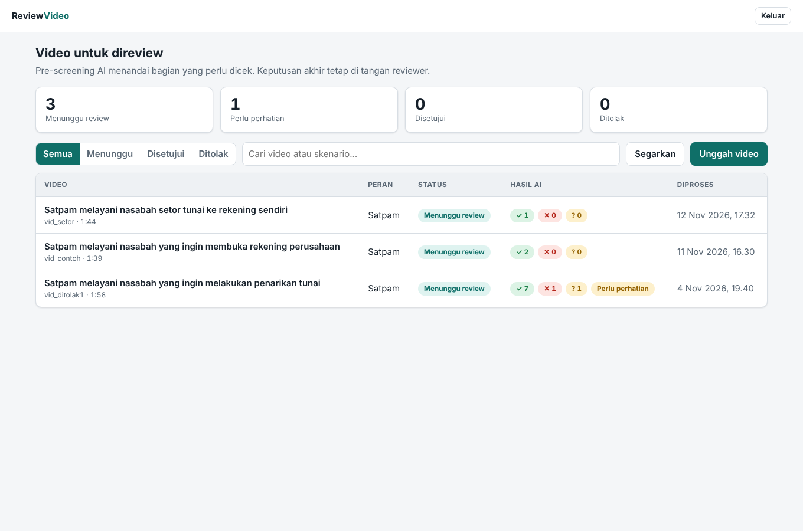 | 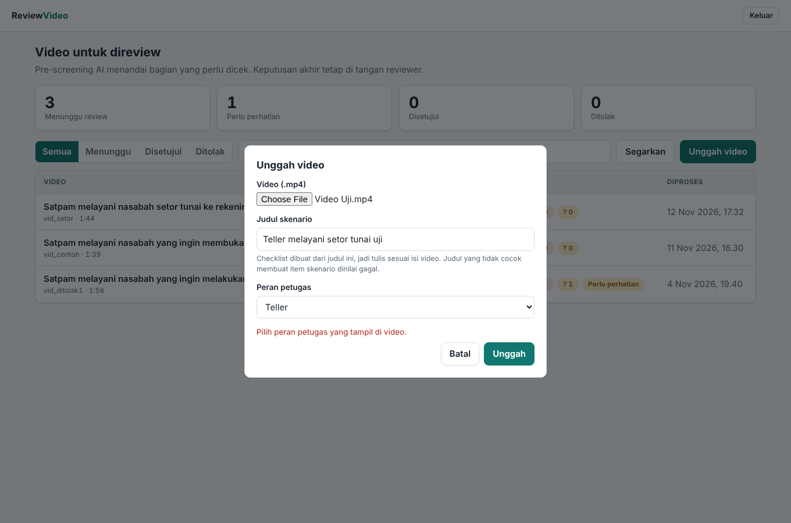 |

Fitur utama halaman review:

- **Heatmap** hijau/merah/kuning dengan pola garis di zona merah (aman untuk buta warna).
- **Kecepatan otomatis**: 1.5× di zona aman, 1× di zona bermasalah/ragu; bisa diganti manual (1×/1.5×/2×).
- **Checklist klik-untuk-lompat**: klik item, video melompat ke 2 detik sebelum momen atau awal rentang bermasalah. Kutipan ucapan dan detik frame juga bisa diklik.
- **Perlu dicek vs Lolos**: item gagal, ragu, dan *pass dengan confidence < 0.8* ("Perlu dilirik") muncul di atas.
- **Override per item**: Setuju AI / Lolos / Gagal + catatan. Hanya yang berbeda dari AI yang disimpan.
- **Edit checklist**: tambah, ubah, nonaktifkan, hapus item.
- **Keputusan akhir** Setujui/Tolak dengan konfirmasi bila masih ada item belum ditinjau.
- Pintasan keyboard: `K` putar/jeda, `J`/`L` mundur/maju 5 detik.
- Tema terang/gelap dan tata letak responsif.

| Gelap | Mobile |
|---|---|
| 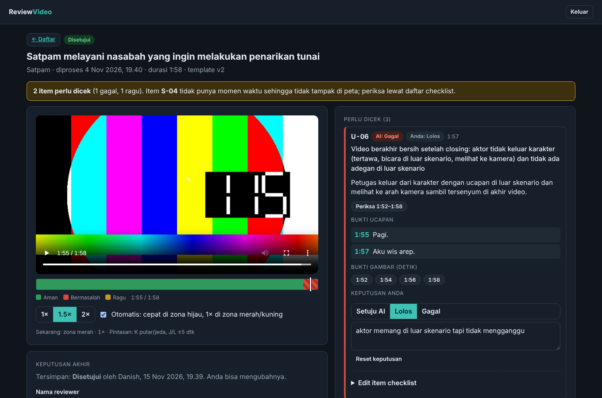 | 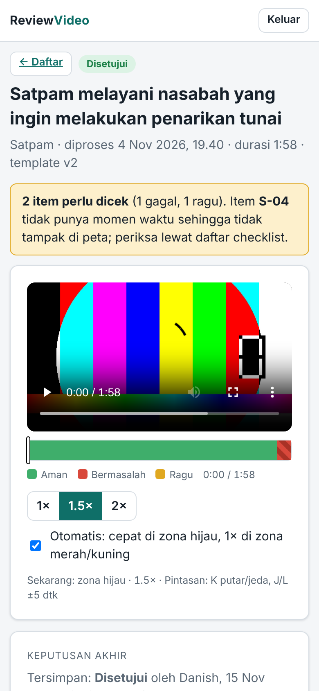 |

Frontend tidak memakai library UI atau router eksternal: router hash dibuat sendiri, logika murni (`src/lib`) dipisah dari komponen agar bisa diuji. Panduan: [frontend/PANDUAN-FRONTEND.md](frontend/PANDUAN-FRONTEND.md).

## 10. Struktur proyek

```
.
├── core/                  # logika inti pipeline (tanpa AWS)
│   ├── schemas.py         # kontrak data Pydantic
│   ├── pipeline.py        # orkestrasi: audio → frame → evaluasi → timeline
│   ├── audio.py, frames.py, asr_gemini.py
│   ├── evaluate.py        # penilaian Gemini + aturan prompt
│   ├── checklist_gen.py   # pembuatan checklist skenario
│   ├── universal_rules.py # aturan U-xx per peran
│   ├── template_store.py, template_edit.py
│   ├── timeline.py, transcripts.py, textmetrics.py
│   ├── storage.py         # file lokal & DynamoDB (float↔Decimal)
│   └── gemini_retry.py    # retry 503/429
├── api/                   # FastAPI + Mangum
│   ├── main.py, service.py, lambda_handler.py
├── handler.py             # Lambda pipeline (S3 / SQS / manual)
├── run_local.py           # jalankan pipeline di laptop
├── repeat_eval.py         # uji kestabilan N kali run
├── compare_asr.py         # bandingkan ASR
├── events/                # contoh event uji
├── templates/             # contoh template skenario
├── tests/                 # test_core.py, test_api.py
├── frontend/              # dashboard React + API tiruan (mock/)
├── Dockerfile             # image Lambda pipeline
├── Dockerfile.api         # image Lambda API
└── PANDUAN-*.md           # panduan Docker, AWS, API
```

## 11. Menjalankan lokal

Prasyarat: Python 3.12, ffmpeg, Node 20+, API key Gemini (aistudio.google.com).

**Pipeline di laptop**
```powershell
python -m venv .venv
.venv\Scripts\Activate.ps1
pip install -r requirements.txt
$env:GEMINI_API_KEY = Read-Host "Gemini API key"
python run_local.py contoh.mp4 "Satpam melayani nasabah ..." --role satpam --asr gemini
```

**Uji kestabilan** (jalankan N kali dan bandingkan hasil)
```powershell
python repeat_eval.py contoh.mp4 "Satpam melayani nasabah ..." --role satpam --runs 3
```

**Dashboard dengan API tiruan**
```powershell
cd frontend
npm install
npm run mock    # http://localhost:8787, token: demo
npm run dev     # http://localhost:5173
```

**Menjalankan lewat Docker**: lihat [PANDUAN-DOCKER.md](PANDUAN-DOCKER.md).

## 12. Deploy ke AWS

Ringkasnya: buat bucket S3 → SQS (+DLQ) → tabel DynamoDB → repo ECR → build dan push dua image (`Dockerfile`, `Dockerfile.api`) → buat dua Lambda → pasang trigger S3→SQS→Lambda → aktifkan Function URL untuk Lambda API → deploy frontend ke Cloudflare Pages.

Catatan penting:
- Build dengan `docker build --provenance=false`, karena Lambda tidak menerima manifest ber-attestation.
- Lambda tidak otomatis memakai image `latest` baru: setelah push, pilih **Deploy new image**.
- DynamoDB harus mode **provisioned**; mode on-demand tidak gratis.

Langkah lengkap beserta variabel lingkungan: [PANDUAN-AWS.md](PANDUAN-AWS.md) dan [PANDUAN-API.md](PANDUAN-API.md).

**Biaya:** Lambda, DynamoDB, dan SQS masuk free tier tetap. S3 dan ECR ditanggung kredit akun baru lalu berbayar kecil. Biaya Gemini mengikuti kuota API.

## 13. Keamanan

- Tidak ada rahasia di repo. API key dan token hanya lewat variabel lingkungan; `.env` masuk `.gitignore`.
- API **fail closed**: tanpa `API_TOKEN` terkonfigurasi semua permintaan ditolak.
- Video diunggah dan diputar lewat **presigned URL** berumur pendek, bucket tidak dibuka publik.
- Keputusan reviewer dan hasil AI di tabel terpisah sehingga jejak audit tetap utuh.
- Token di browser disimpan di `localStorage` (try/catch); respons 401 otomatis memicu logout.
- CORS dipersempit ke alamat dashboard setelah deploy (lihat panduan frontend).
- Jangan pernah meng-commit file kredensial (`*.csv` access key, `.env`). Gunakan IAM user/role dengan hak minimum.

## 14. Pengujian

```powershell
pytest tests/                 # backend: core + API (56 tes)
cd frontend; npm test         # logika murni frontend (8 tes)
```

- Backend menguji skema, timeline, template, penyimpanan DynamoDB (float↔Decimal), edit template, dan logika layanan API.
- Frontend: logika `timeline`, `review`, dan format diuji dengan `node --test`.
- UI diverifikasi end-to-end dengan Playwright terhadap API tiruan (26 pemeriksaan: login, unggah, review, override, edit checklist, keputusan, tema gelap, mobile).

## 15. Keputusan desain

| Keputusan | Alasan |
|---|---|
| Peran lewat **dropdown**, bukan dideteksi AI | Lebih andal dan murah; peran menentukan aturan universal |
| Dua Lambda terpisah | Beban dan durasi sangat berbeda; API tetap cepat |
| Upload langsung ke S3 | Tidak ada batas payload API Gateway/Lambda |
| SQS di depan pipeline | Meredam lonjakan, retry otomatis, DLQ |
| Aturan universal sebagai kode | Konsisten dan tidak bergantung pada kreativitas model |
| `temperature = 0` + aturan "tanpa bukti = uncertain" | Menekan halusinasi dan variasi antar run |
| Hasil AI dan review di tabel terpisah | Jejak audit; AI tidak menimpa manusia |
| Gemini untuk transkripsi (bukan Whisper di Lambda) | Image kecil, cold start cepat, bahasa Indonesia baik |
| Lambda Function URL, bukan API Gateway | Gratis dan cukup untuk kebutuhan ini |
| DynamoDB provisioned | Tetap gratis di free tier |

## 16. Keterbatasan dan rencana

Yang diketahui:
- Judul yang tidak sesuai isi video menghasilkan penilaian menyesatkan (belum ada pengecekan kesesuaian judul).
- Item skenario buatan AI bisa salah sasaran; mitigasinya adalah edit checklist manual.
- Frame bukti belum disimpan, jadi dashboard menampilkan detik bukti, bukan gambarnya.
- Satu token bersama untuk semua pengguna; belum ada akun per orang atau pemisahan uploader/reviewer.
- Hasil lama tanpa `source` tidak bisa memutar video.
- Penilaian bergantung pada Gemini sehingga tetap perlu reviewer manusia.

Rencana:
- [ ] Pengecekan kesesuaian judul dengan isi video
- [ ] Penandaan *pass* ber-confidence rendah dari sisi backend
- [ ] Voting 3 kali run untuk item batas
- [ ] Simpan dan tampilkan frame bukti
- [ ] Pemisahan peran uploader dan reviewer (dua token, lalu Cognito)
- [ ] Infrastruktur sebagai kode (SAM / CDK)

## Lisensi

Proyek pembelajaran. Tambahkan lisensi pilihanmu (misalnya MIT) bila ingin dipakai orang lain.
